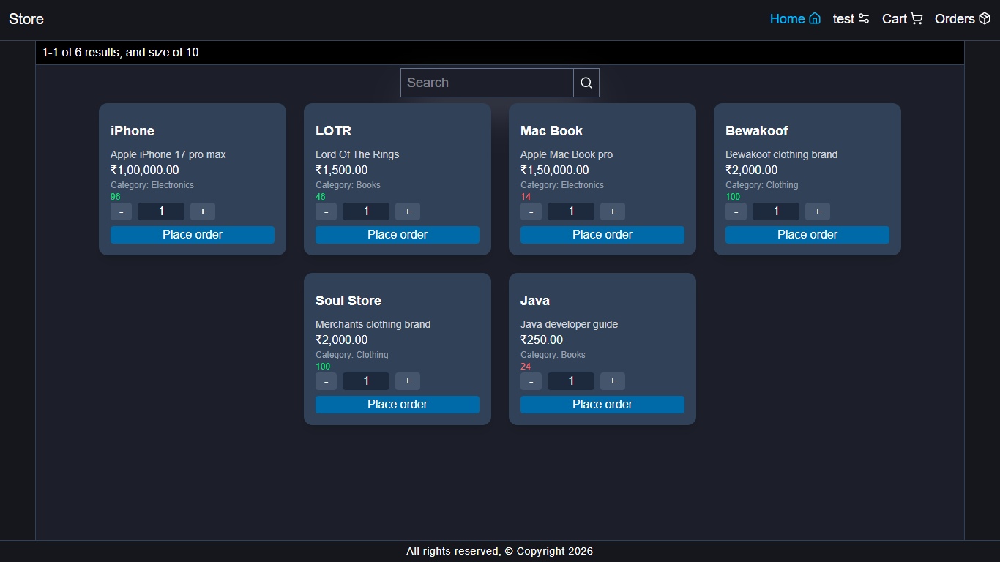
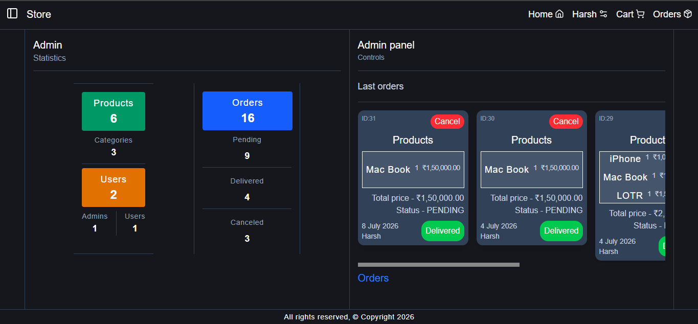
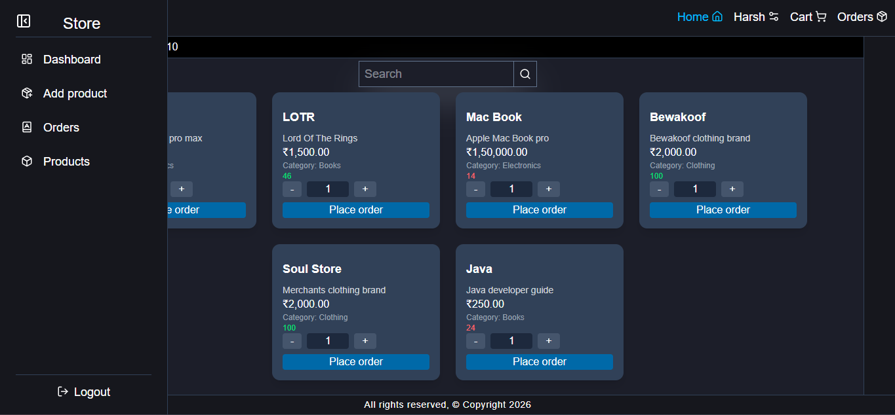
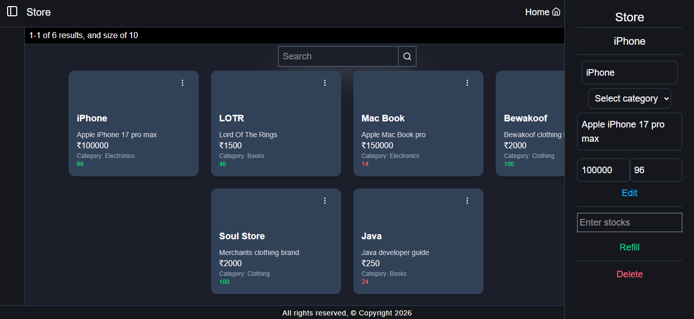

# About the project 🏪

[](LICENSE)
[](https://java.com)
[](https://spring.io)
[](https://react.dev)

A full-stack online store application built with React and Spring Boot, featuring user authentication, product management, and an admin dashboard.

## Screenshots 🖼️

### Landing Page

> *This page shows products available for users to purchase.*

### Dashboard Admin

> *The main control center showing system stats and last orders for admins.*

### Sidebar for Admin

> *This sidebar shows the admin navigation menu.*

### Product Management Page Admin

> *This page shows product management for admins.*

## Features 💻

### User 👤
* User login & signup system
* Direct ordering system (no cart system)
* Search products

### Admin 🧑‍💻
* Admin panel
* Admin stats
* Add, edit, and delete products
* Refill stock
* Deliver and cancel orders
* Change user roles

## Frontend
- React
- Tailwind CSS
- Vite
- npm

## Backend
- Java 25
- Spring Boot
- Spring Security
- Spring Data JPA
- MySQL
- Maven

## To run the project 🚀

### Frontend 
```bash
cd frontend
npm install
npm run dev
```

### Backend
Windows
```bash
cd firstSpring
mvnw.cmd spring-boot:run
```

MacOS/Linux
```bash
cd firstSpring
./mvnw spring-boot:run
```


### TODO 📋
* Integrate the change role feature into the frontend

### Note ⚠️
* The edit feature of the user profile is not completed